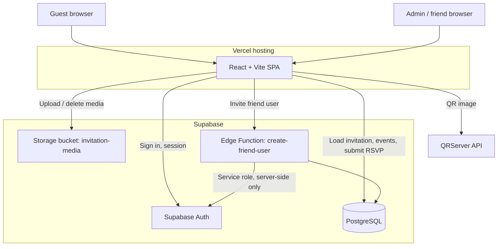
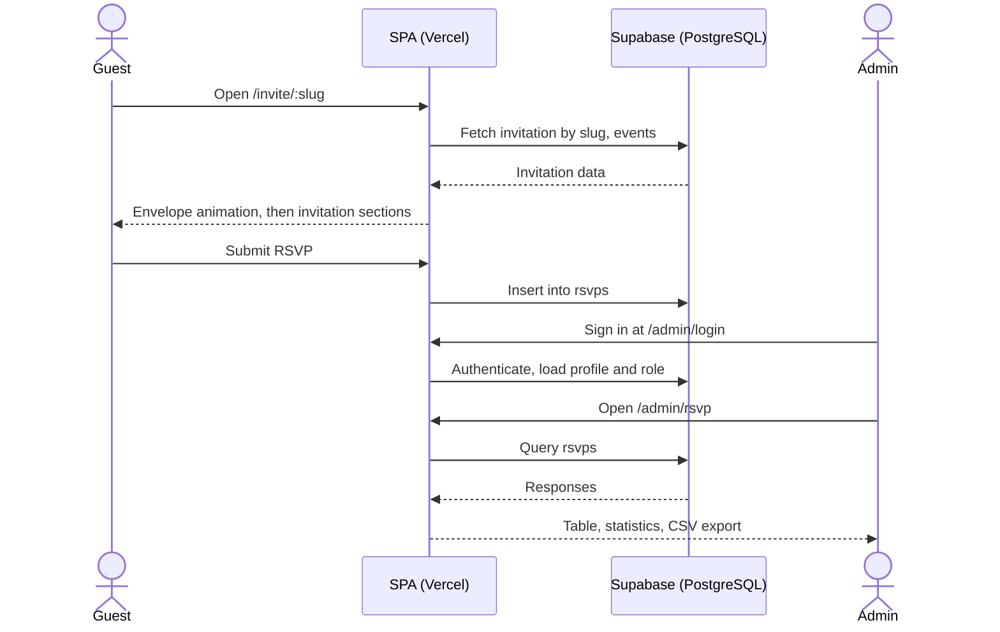

<div align="center">

# Noor-e-Nikah

**A dynamic, multi-invitation digital Nikah platform with an animated guest experience and a role-based admin dashboard.**


Repository: [github.com/akramiyi](https://github.com/akramiyi)

Live demo: to be added

</div>

---

## Table of Contents

1. [Overview](#overview)
2. [Live Demo](#live-demo)
3. [Screenshots](#screenshots)
4. [Key Features](#key-features)
5. [Technology Stack](#technology-stack)
6. [System Architecture](#system-architecture)
7. [Application Workflow](#application-workflow)
8. [Project Structure](#project-structure)
9. [Database Design](#database-design)
10. [Authentication and Security](#authentication-and-security)
11. [Installation and Local Development](#installation-and-local-development)
12. [Environment Configuration](#environment-configuration)
13. [Supabase Configuration](#supabase-configuration)
14. [Deployment](#deployment)
15. [Admin Panel Guide](#admin-panel-guide)
16. [Known Limitations](#known-limitations)
17. [Roadmap](#roadmap)
18. [Contributing](#contributing)
19. [License](#license)
20. [Author](#author)

---

## Overview

Noor-e-Nikah is a full-stack web application for creating and sharing digital Nikah (Muslim wedding) invitations. Each invitation lives at its own URL and opens with an animated envelope, followed by a scroll-driven presentation of the couple's details, venue, events, countdown, RSVP form, blessings and host contacts.

Administrators manage invitations, events, media and guest RSVPs from a protected dashboard. A Super Admin can invite additional "friend" users and assign them to specific invitations.

**Target users**

| Audience | Value |
|---|---|
| Couples and families | A personalized, shareable invitation without printing or manual RSVP tracking |
| Guests | A single link to view event details and respond |
| Developers and freelancers | A reference implementation of a multi-tenant React + Supabase application |

## Live Demo

Live demo: to be added

No public sample invitation URL or demo credentials are provided at this time.

## Screenshots

Screenshots will be added under `docs/screenshots/`.

| Section | Preview |
|---|---|
| Invitation Hero | <!-- TODO:  --> |
| Envelope Opening Animation | <!-- TODO:  --> |
| Islamic Verse Section | <!-- TODO:  --> |
| Wedding Invitation | <!-- TODO:  --> |
| Venue | <!-- TODO:  --> |
| Wedding Events | <!-- TODO:  --> |
| Countdown | <!-- TODO:  --> |
| RSVP | <!-- TODO:  --> |
| Blessings | <!-- TODO:  --> |
| Hosts and Contact | <!-- TODO:  --> |
| Admin Dashboard | <!-- TODO:  --> |

## Key Features

### Public invitation (`/invite/:slug`)

| Feature | Component |
|---|---|
| Wax-seal envelope opening (video) | `IntroAnimation.tsx` |
| Looping Naat audio player | `AudioPlayer.tsx` |
| Hero with animated golden snow particles | `HeroSection.tsx` |
| Surah Ar-Rum verse section | `CoupleStory.tsx` |
| Interactive star-seal invitation card | `InvitationSection.tsx` |
| Venue details and QR code | `VenueSection.tsx` |
| Scroll-animated events timeline | `EventTimeline.tsx` |
| Live wedding countdown | `CountdownSection.tsx` |
| RSVP submission | `RSVP.tsx` |
| Blessings | `Blessings.tsx` |
| Hosts and contact | `HostsContact.tsx` |
| Monogram closing and footer | `Footer.tsx` |
| Ambient custom cursor | `CustomCursor.tsx` |

### Admin platform (`/admin/*`)

| Feature | Component |
|---|---|
| Email/password sign-in with role-based access (`super_admin`, `friend`) | `AuthContext.tsx`, `ProtectedRoute.tsx` |
| Dashboard statistics and recent activity | `DashboardOverview.tsx` |
| Invitation create, edit, delete and publish toggle | `InvitationsList.tsx`, `InvitationForm.tsx` |
| Event create, edit and delete | `EventsList.tsx`, `EventForm.tsx` |
| RSVP analytics and CSV export | `RSVPsList.tsx` |
| Media upload and deletion (`invitation-media` bucket) | `MediaList.tsx` |
| Friend user invitation and invitation assignment | `UsersList.tsx`, `create-friend-user` Edge Function |
| Profile settings | `Settings.tsx` |

## Technology Stack

| Category | Technology | Version |
|---|---|---|
| Framework | React | ^19.2.8 |
| Routing | react-router-dom | ^7.18.3 |
| Language | TypeScript | ~6.0.2 |
| Build tool | Vite | ^8.3.0 |
| Vite plugin | @vitejs/plugin-react | ^6.1.1 |
| Animation | GSAP with ScrollTrigger | ^3.15.0 |
| Styling | CSS Modules (`*.module.css`), CSS custom properties (`src/index.css`) | n/a |
| Fonts | Playfair Display, Amiri, Cormorant Garamond, Jost (Google Fonts) | n/a |
| Backend platform | Supabase (`@supabase/supabase-js`) | ^2.116.0 |
| Serverless | Supabase Edge Function (Deno runtime) | n/a |
| External service | QRServer API (QR code on venue section) | n/a |
| Linting | oxlint (`.oxlintrc.json`) | ^1.81.0 |
| Hosting | Vercel (SPA rewrite via `vercel.json`) | n/a |

## System Architecture



The application is a single-page app served by Vercel. All data access goes directly from the browser to Supabase using the publishable key. The service-role key is used only inside the Edge Function.

> PostgreSQL Row Level Security and Storage policies are not version-controlled in this repository. See [Authentication and Security](#authentication-and-security).

## Application Workflow



1. **Opening an invitation.** The guest visits `/invite/:slug`. The app loads the invitation and its data from Supabase and plays the envelope animation.
2. **RSVP.** The guest submits the RSVP form. The response is stored in the `rsvps` table.
3. **Review.** An authenticated admin opens the RSVP module to view responses, see statistics and export CSV.
4. **Management.** Admins create and publish invitations, manage events and upload media. A Super Admin invites friend users and assigns invitations.

## Project Structure

Only paths confirmed during repository inspection are listed.

```
.
├── index.html                          # Entry HTML, Google Fonts
├── vercel.json                         # SPA rewrite
├── .oxlintrc.json                      # Lint configuration
├── .env.example                        # Environment variable template
├── src/
│   ├── App.tsx                         # Route definitions
│   ├── index.css                       # Global styles, CSS custom properties
│   └── lib/
│       └── supabase.ts                 # Supabase client (reads VITE_* variables)
└── supabase/
    └── functions/
        └── create-friend-user/
            └── index.ts                # Edge Function (Deno)
```

Public and admin components listed under [Key Features](#key-features) live under `src/`.

## Database Design

Tables referenced by the application code:

| Table | Purpose |
|---|---|
| `invitations` | Invitation records, including slug, wedding date and published state |
| `profiles` | User profiles and roles (`super_admin`, `friend`) |
| `invitation_members` | Assignment of friend users to invitations |
| `events` | Events belonging to an invitation |
| `rsvps` | Guest RSVP responses |
| `media` | Metadata for uploaded media |

Storage bucket: `invitation-media`.

The schema is not defined in this repository (no `supabase/migrations/` directory). Column definitions must be taken from your own Supabase project.

## Authentication and Security

| Layer | Mechanism | In this repository |
|---|---|---|
| Authentication | Supabase Auth | Client usage in `AuthContext.tsx` |
| Route protection | `ProtectedRoute` guards `/admin/*`; role checks in the admin UI | Yes (frontend) |
| Privileged operations | `create-friend-user` Edge Function uses the service-role key server-side | Yes (source only) |
| Row Level Security | Configured in the Supabase Dashboard | Not version-controlled |
| Storage policies | Configured in the Supabase Dashboard | Not version-controlled |
| Secrets | Frontend uses only `VITE_*` variables; `.env.example` contains placeholders | Yes |

**Important:** frontend route guards improve user experience but are not a security boundary. Data isolation between invitations and roles must be enforced by RLS and Storage policies in Supabase. Verify these policies in your own project before going to production.

Never expose the `SUPABASE_SERVICE_ROLE_KEY` in frontend code or commit it to the repository.

## Installation and Local Development

**Prerequisites:** Node.js (current LTS recommended), npm, and a Supabase project.

```bash
git clone https://github.com/akramiyi/<repository-name>.git
cd <repository-name>
npm install
cp .env.example .env.local
npm run dev
```

Confirm the available scripts in the `scripts` section of `package.json` (standard Vite projects provide `dev`, `build` and `preview`).

## Environment Configuration

Copy `.env.example` to `.env.local` and fill in your own values.

| Variable | Scope | Description |
|---|---|---|
| `VITE_SUPABASE_URL` | Frontend | Supabase project URL |
| `VITE_SUPABASE_PUBLISHABLE_KEY` | Frontend | Supabase publishable (anon) key |
| `SUPABASE_URL` | Edge Function | Provided by Supabase at runtime |
| `SUPABASE_ANON_KEY` | Edge Function | Provided by Supabase at runtime |
| `SUPABASE_SERVICE_ROLE_KEY` | Edge Function | Server-side only. Never expose to the browser |

Find the URL and publishable key in the Supabase Dashboard under **Project Settings > API**.

## Supabase Configuration

1. Create a Supabase project.
2. Create the tables listed in [Database Design](#database-design).
3. Enable Row Level Security on each table and define policies for invitation-level access and role-based access.
4. Create a Storage bucket named `invitation-media` and define its access policies.
5. Enable email/password authentication and create the first Super Admin user, setting its role in `profiles`.
6. Deploy the Edge Function with the Supabase CLI:

```bash
supabase functions deploy create-friend-user
```

This repository does not include migration files or policy scripts, and the deployment status of the Edge Function cannot be verified from the repository.

## Deployment

The frontend is designed for deployment on Vercel.

1. Import the GitHub repository into Vercel.
2. Use the Vite framework preset (build command `npm run build`, output directory `dist`).
3. Add `VITE_SUPABASE_URL` and `VITE_SUPABASE_PUBLISHABLE_KEY` as environment variables.
4. Deploy.

`vercel.json` contains the SPA rewrite so that direct visits to `/invite/:slug` and `/admin/*` resolve to the app. After deploying, open an invitation URL directly and refresh to confirm routing works.

Supabase remains the production backend for authentication, database, storage and the Edge Function.

## Admin Panel Guide

| Route | Module | Purpose |
|---|---|---|
| `/admin/login` | Login | Admin sign-in |
| `/admin` | Dashboard | Statistics and recent activity |
| `/admin/invitations` | Invitations | List, publish toggle |
| `/admin/invitations/new` | Invitations | Create invitation |
| `/admin/invitations/:id/edit` | Invitations | Edit invitation |
| `/admin/invitations/:invitationId/events` | Events | Events of one invitation |
| `/admin/invitations/:invitationId/events/new` | Events | Create event |
| `/admin/invitations/:invitationId/events/:eventId/edit` | Events | Edit event |
| `/admin/events` | Events | All events |
| `/admin/rsvp` | RSVP | Responses, analytics, CSV export |
| `/admin/media` | Media | Upload and delete files |
| `/admin/users` | Users | Invite friend users, assign invitations |
| `/admin/settings` | Settings | Profile settings |

Public routes: `/` and `/invite/:slug`.

## Known Limitations

- No SQL migrations or RLS and Storage policy scripts are included in this repository.
- The Edge Function's remote deployment cannot be verified from repository files.
- The public invitation does not yet render a media gallery from the `media` table.
- No demo credentials or public sample invitation are provided.
- The venue QR code depends on the external QRServer API.
- The repository contains a few legacy components that are not used by the current routes.

## Roadmap

Planned improvements, not yet implemented:

- Version-controlled Supabase migrations and RLS policies.
- Public media gallery on the invitation page.
- Published screenshots and a public demo invitation.

## Contributing

1. Fork the repository and create a branch: `git checkout -b feature/your-change`.
2. Keep changes focused and follow the existing TypeScript and CSS Modules conventions.
3. Run the linter (oxlint) and make sure the project builds before opening a pull request.
4. Never commit `.env` files or credentials.
5. Open a pull request describing the change and how you tested it.

## License

No open-source license is currently specified for this project. All rights are reserved by the author until a license is added.

## Author

**Akram Ansari**
GitHub: [github.com/akramiyi](https://github.com/akramiyi)
