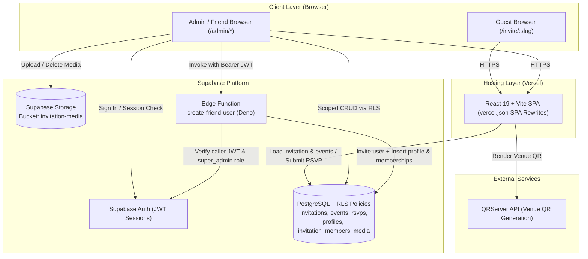
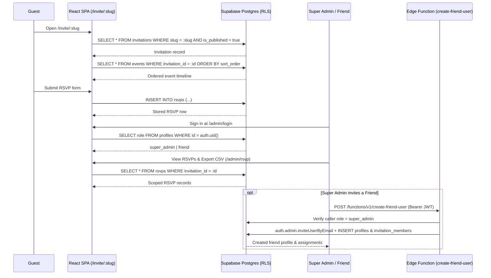

# Noor-e-Nikah — Nikah Invitation Platform

**A full-stack, multi-tenant digital Muslim wedding (Nikah) invitation platform featuring an animated, interactive guest experience and a role-based administrative dashboard.**

[](https://react.dev/)
[](https://www.typescriptlang.org/)
[](https://vite.dev/)
[](https://reactrouter.com/)
[](https://greensock.com/gsap/)
[](https://supabase.com/)
[](https://vercel.com/)

- **Repository:** [https://github.com/akramiyi/nikah-invitation](https://github.com/akramiyi/nikah-invitation)
- **Live Demo:** Not published in repository metadata (see [Live Demo](#live-demo))

---

## Table of Contents

1. [Project Overview](#project-overview)
2. [Live Demo](#live-demo)
3. [Screenshots & Preview](#screenshots--preview)
4. [Key Features](#key-features)
5. [Technology Stack](#technology-stack)
6. [System Architecture](#system-architecture)
7. [Application Workflow](#application-workflow)
8. [Project Structure](#project-structure)
9. [Database Design](#database-design)
10. [Authentication & Security](#authentication--security)
11. [Installation & Local Development](#installation--local-development)
12. [Environment Configuration](#environment-configuration)
13. [Supabase Configuration](#supabase-configuration)
14. [Deployment Guide](#deployment-guide)
15. [Admin Panel Guide](#admin-panel-guide)
16. [Responsive Design](#responsive-design)
17. [Performance & Accessibility](#performance--accessibility)
18. [Known Limitations](#known-limitations)
19. [Future Roadmap](#future-roadmap)
20. [Contribution Guidelines](#contribution-guidelines)
21. [License](#license)
22. [Author](#author)

---

## Project Overview

**Noor-e-Nikah** is a dynamic, multi-invitation digital Nikah invitation platform built with React, TypeScript, Vite, GSAP, and Supabase. Instead of generating static single-couple wedding pages, the platform stores multiple wedding invitations, event schedules, RSVP responses, and media assets in a centralized PostgreSQL database and serves each published wedding at a dedicated slug URL (`/invite/:slug`).

### What Problem It Solves

- **Replacing static templates with multi-invitation management:** Families and coordinators can create, publish, and update wedding details, event timelines, and venue links from a web dashboard without editing source code or redeploying.
- **Centralized guest RSVP tracking:** Guests submit attendance, headcount, and blessings directly on the invitation page, while authorized hosts view metrics and export guest lists to CSV.
- **Delegated access control:** A Super Admin can invite and assign `friend` collaborators to manage events, media, and RSVPs for specific invitations without exposing all invitations across the platform.

### Target Users

- **Wedding Guests:** Receive a personalized `/invite/:slug` link featuring an interactive wax-seal envelope opening, Quranic verse, venue directions with a scannable QR code, live countdown, and RSVP form.
- **Super Administrators:** Manage the entire platform—creating invitations, publishing/unpublishing URLs, managing events and media, and provisioning `friend` accounts.
- **Assigned Collaborators (`friend` role):** View analytics, RSVP responses, events, and media scoped strictly to their assigned invitations.

---

## Live Demo

| Item | Status | Notes |
| --- | --- | --- |
| **Production URL** | Not stored in repository | Configured for Vercel SPA deployment via [`vercel.json`](vercel.json); no verified production URL is committed in the codebase. |
| **Sample Invitation URL** | Unavailable | Public invitations load dynamically from Supabase at `/invite/<slug>` where `is_published = true`. |
| **Demo Admin Credentials** | Unavailable | Authentication is managed by Supabase Auth; no default or demo credentials are included in the repository. |

---

## Screenshots & Preview

> **Note:** No UI screenshots are currently committed in the repository (`src/assets/` contains runtime visual and audio media only). Add captured screenshots under `docs/screenshots/` and replace the placeholders below before publishing a release.

<details>
<summary>Expand Screenshot Placeholders (Public Stages 1–10 & Admin Dashboard)</summary>

### 1. Invitation Hero
<!-- TODO: Add screenshot of HeroSection (couple names, emerald/gold overlay, golden snow particles, CTAs) -->
*Placeholder — Screenshot not yet captured (`src/components/HeroSection/HeroSection.tsx`).*

### 2. Envelope Opening Animation
<!-- TODO: Add screenshot/GIF of IntroAnimation (wax seal tap, expanding light rays, video reveal) -->
*Placeholder — Screenshot not yet captured (`src/components/IntroAnimation/IntroAnimation.tsx`).*

### 3. Islamic Verse Section
<!-- TODO: Add screenshot of CoupleStory (Surah Ar-Rum 30:21 Arabic calligraphy, translation, gold arch) -->
*Placeholder — Screenshot not yet captured (`src/components/nikah/CoupleStory.tsx`).*

### 4. Wedding Invitation
<!-- TODO: Add screenshot of InvitationSection (interactive star-sealed invitation card) -->
*Placeholder — Screenshot not yet captured (`src/components/nikah/InvitationSection.tsx`).*

### 5. Venue
<!-- TODO: Add screenshot of VenueSection (venue details, parking note, dynamic QR code, Open in Maps button) -->
*Placeholder — Screenshot not yet captured (`src/components/nikah/VenueSection.tsx`).*

### 6. Wedding Events
<!-- TODO: Add screenshot of EventTimeline (alternating gold-bordered event cards and scroll-lit nodes) -->
*Placeholder — Screenshot not yet captured (`src/components/nikah/EventTimeline.tsx`).*

### 7. Countdown
<!-- TODO: Add screenshot of CountdownSection (live Days/Hours/Min/Sec frame with floating gold particles) -->
*Placeholder — Screenshot not yet captured (`src/components/nikah/CountdownSection.tsx`).*

### 8. RSVP
<!-- TODO: Add screenshot of RSVP form section (guest details, attendance toggle, headcount, message) -->
*Placeholder — Screenshot not yet captured (`src/components/nikah/RSVP.tsx`).*

### 9. Blessings
<!-- TODO: Add screenshot of Blessings section (Your Presence and Duas cards) -->
*Placeholder — Screenshot not yet captured (`src/components/nikah/Blessings.tsx`).*

### 10. Hosts & Contact
<!-- TODO: Add screenshot of HostsContact section (Groom's Family & Bride's Family columns with tel links) -->
*Placeholder — Screenshot not yet captured (`src/components/nikah/HostsContact.tsx`).*

### 11. Admin Dashboard
<!-- TODO: Add screenshot of AdminDashboard (/admin overview, statistics grid, recent invitations and RSVPs) -->
*Placeholder — Screenshot not yet captured (`src/pages/admin/AdminDashboard.tsx`).*

</details>

---

## Key Features

### Public Invitation Experience (`/invite/:slug`)

- **Interactive Envelope Opening:** Full-viewport intro overlay (`IntroAnimation`) featuring a wax seal (`wax-seal.webp`) that triggers GSAP ray animations and plays the envelope-opening video (`0911.mp4`) before revealing the hero section.
- **Background Naat Audio Player:** Bundled audio (`naat.mp3`) begins looping upon wax seal interaction with a floating play/pause equalizer control (`AudioPlayer`).
- **Personalized Hero & Couple Details:** Renders dynamic couple names, wedding date, city extracted from the venue address, hashtag, and `#rsvp` / `#schedule` navigation over an emerald-and-gold visual theme with animated `GoldenSnow` particles (`HeroSection`).
- **Islamic Verse Section:** Displays Surah Ar-Rum (30:21) in RTL Arabic script (`Amiri`) with English translation and gold arch SVG (`CoupleStory`).
- **Interactive Invitation Card:** Expandable card (`InvitationSection`) toggled via a gold star seal, revealing the invitation text and couple signature.
- **Venue & Scannable QR Map:** Displays venue name, address, parking note, an "OPEN IN MAPS" link, and a dynamic QR code generated from `venue_maps_url` via `api.qrserver.com` (`VenueSection`).
- **Database-Driven Events Timeline:** Fetches invitation-specific events ordered by `sort_order`, displaying event numbers, dates, times, Urdu titles, subtitles, and venues along a scroll-scrubbed progress line (`EventTimeline`).
- **Live Wedding Countdown:** Real-time `DAYS | HOURS | MIN | SEC` timer (`CountdownSection`) supporting both `YYYY-MM-DD` and free-text dates (e.g., `December 12, 2026`) alongside 12-hour/24-hour `nikah_time` parsing.
- **Guest RSVP Submission:** Validated form (`RSVP`) submitting guest name, mobile number, email, attendance (`accepted` or `declined`), guest count (`1`–`6`), and optional wishes directly to `public.rsvps`.
- **Blessings, Hosts Contact & Closing Footer:** Dedicated `Blessings` cards, two-column `HostsContact` with clickable `tel:` links, and a closing `Footer` featuring a couple-initials monogram and metadata strip.
- **Ambient Custom Cursor:** Smooth GSAP `quickTo` golden halo cursor (`CustomCursor`) automatically hidden on touch/coarse-pointer devices.

### Multi-Invitation Admin Platform (`/admin/*`)

- **Role-Based Authentication:** Protected admin area (`ProtectedRoute` + `AuthContext`) backed by Supabase Auth and `public.profiles` roles (`super_admin` and `friend`).
- **Dashboard Overview:** Summary metrics (Total Invitations, Published, Events, RSVP Responses, Total Guests, Media Files) plus recent invitations and recent RSVPs scoped by user role (`DashboardOverview`).
- **Multi-Invitation CRUD (`super_admin`):** Create, edit, publish/unpublish, and delete invitations with unique URL slug validation (`[a-z0-9-]`) (`InvitationsList`, `InvitationForm`).
- **Event Schedule Management:** View, add, edit, and remove ordered wedding events per invitation (`EventsList`, `EventForm`).
- **RSVP Analytics & CSV Export:** Filter responses by invitation, view attendance totals and total attending headcount, and download guest data as `rsvp-<slug>.csv` (`RSVPsList`).
- **Media Upload & Storage Management:** Upload validated images (`JPEG`, `PNG`, `WEBP`, `GIF` up to `5 MB`) and videos (`MP4`, `WEBM` up to `50 MB`) to the `invitation-media` Supabase Storage bucket with transactional DB cleanup on failure and safe Storage-first deletion (`MediaList`). *(See [Known Limitations](#known-limitations) regarding public gallery rendering.)*
- **Friend User Onboarding & Assignment (`super_admin`):** Assign or unassign invitations via `invitation_members` and securely invite new `friend` users via the `create-friend-user` Supabase Edge Function (`UsersList`).
- **Profile & Security Settings:** View account role/email, update `full_name` in `public.profiles`, and sign out (`Settings`).

---

## Technology Stack

| Category | Technology | Verified Version / Source |
| --- | --- | --- |
| **Frontend Framework** | React | `^19.2.8` (`package.json`) |
| **Language** | TypeScript | `~6.0.2` (`package.json`) |
| **Routing** | React Router DOM | `^7.18.3` (`package.json`) |
| **Build Tool & Dev Server** | Vite & `@vitejs/plugin-react` | `vite ^8.3.0`, plugin `^6.1.1` |
| **Styling & Typography** | CSS Modules, CSS Custom Properties, Google Fonts (`Playfair Display`, `Amiri`, `Cormorant Garamond`, `Jost`) | `*.module.css`, `index.html`, `src/index.css` |
| **Animations** | GSAP (`gsap` + `ScrollTrigger`) | `^3.15.0` (`package.json`) |
| **Backend & Database** | Supabase PostgreSQL (`@supabase/supabase-js`) | `^2.116.0` (`package.json`) |
| **Authentication** | Supabase Auth (Email/Password + Invite Flow) | `@supabase/supabase-js` |
| **File Storage** | Supabase Storage (`invitation-media` bucket) | `src/pages/admin/media/MediaList.tsx` |
| **Serverless Functions** | Supabase Edge Functions (Deno) | `supabase/functions/create-friend-user/index.ts` |
| **QR Code Service** | QRServer API (external image endpoint) | `api.qrserver.com/v1/create-qr-code` |
| **Linting** | Oxlint | `^1.81.0` (`.oxlintrc.json`) |
| **Hosting & Routing** | Vercel (Static build + SPA rewrites) | `vercel.json` |

---

## System Architecture

The application is a client-rendered Single Page Application (SPA) hosted on Vercel that communicates directly with Supabase services over HTTPS using the public publishable key, while privileged user creation runs server-side in a Supabase Edge Function.



---

## Application Workflow

### 1. Guest Invitation & RSVP Flow

1. A guest navigates to `/invite/:slug`.
2. `NikahInvite` queries `public.invitations` filtering by `slug` and `is_published = true`. If missing or unpublished, an *"Invitation Unavailable"* fallback screen renders.
3. The fetched record is passed into `InvitationProvider`, exposing `useInvitation()` to all child sections.
4. `IntroAnimation` locks body scrolling until the guest taps the wax seal, which triggers `AudioPlayer` (`naat.mp3`), animates GSAP rays, plays `0911.mp4`, and fades into `HeroSection`.
5. As the guest scrolls, `EventTimeline` fetches rows from `public.events` matching `invitation.id` ordered by `sort_order`, and `VenueSection` encodes `invitation.venue_maps_url` into a scannable QR image.
6. In `RSVP`, the guest submits attendance (`accepted` or `declined`), guest count, contact details, and an optional message; the payload is inserted into `public.rsvps`.

### 2. Admin & Collaborator Management Flow

1. An administrator or assigned friend signs in at `/admin/login` using email and password via `supabase.auth.signInWithPassword`.
2. `AuthContext` retrieves the active session and queries `public.profiles` for the user's `role` (`super_admin` or `friend`).
3. `ProtectedRoute` restricts `/admin/*` to authenticated users holding `super_admin` or `friend` roles.
4. `Super Admin` users can manage all invitations, events, RSVPs, media files, and user assignments, and invoke `create-friend-user` to invite new `friend` collaborators.
5. `Friend` users query `public.invitation_members` to retrieve only their assigned `invitation_id`s and view scoped metrics, events, RSVPs, and media.



---

## Project Structure

```text
Nikah/
├── .env.example                            # Template for required Vite Supabase environment variables
├── .gitignore                              # Git ignore rules (node_modules, dist, *.local, etc.)
├── .oxlintrc.json                          # Oxlint configuration for React & TypeScript
├── index.html                              # Root HTML entry loading Google Fonts & mounting #root
├── package.json                            # Dependencies and npm scripts (dev, build, lint, preview)
├── package-lock.json                       # Locked dependency tree
├── vercel.json                             # Vercel SPA fallback rewrite to /index.html
├── vite.config.ts                          # Vite configuration with @vitejs/plugin-react
├── tsconfig.json                           # TypeScript project references
├── tsconfig.app.json                       # App TypeScript compiler options
├── tsconfig.node.json                      # Node/Vite config TypeScript options
├── public/
│   ├── favicon.svg                         # Site favicon
│   ├── icons.svg                           # SVG icon definitions
│   └── compare.html                        # Development visual comparison helper page
├── supabase/
│   ├── config.toml                         # Supabase CLI local development & function configuration
│   └── functions/
│       └── create-friend-user/
│           ├── deno.json                   # Deno import map for Edge Function
│           └── index.ts                    # Secure friend user creation & rollback logic
└── src/
    ├── App.tsx                             # Router definitions for public & protected admin routes
    ├── main.tsx                            # React root mount
    ├── index.css                           # Global theme tokens & base typography
    ├── App.css                             # Legacy/template root styles
    ├── assets/                             # Bundled media (0911.mp4, naat.mp3, wax-seal.webp, hero imagery)
    ├── lib/
    │   └── supabase.ts                     # Singleton Supabase client initialization
    ├── contexts/
    │   ├── AuthContext.tsx                 # Auth session listener & profile role loader
    │   └── InvitationContext.tsx           # InvitationData interface & context provider
    ├── config/
    │   └── weddingConfig.ts                # Legacy static config (unused by dynamic NikahInvite)
    ├── pages/
    │   ├── NikahInvite.tsx                 # Dynamic public invitation page (/invite/:slug)
    │   └── admin/
    │       ├── AdminLogin.tsx              # Admin authentication view (/admin/login)
    │       ├── AdminDashboard.tsx          # Admin layout shell, sidebar navigation, route dispatch
    │       ├── dashboard/
    │       │   └── DashboardOverview.tsx   # Role-scoped metrics & recent activity tables
    │       ├── invitations/
    │       │   ├── InvitationsList.tsx     # Invitation directory, publish toggle, delete
    │       │   └── InvitationForm.tsx      # Create/edit invitation form & slug validation
    │       ├── events/
    │       │   ├── EventsList.tsx          # Invitation-filtered events table
    │       │   └── EventForm.tsx           # Create/edit wedding event form
    │       ├── rsvps/
    │       │   └── RSVPsList.tsx           # RSVP summary cards, table, and CSV export
    │       ├── media/
    │       │   └── MediaList.tsx           # Media gallery manager & Supabase Storage uploader
    │       ├── users/
    │       │   └── UsersList.tsx           # Super-admin user list, member assignments, invite modal
    │       └── settings/
    │           └── Settings.tsx            # User profile editor, security info, sign out
    └── components/
        ├── CustomCursor/                   # GSAP ambient golden halo cursor
        ├── IntroAnimation/                 # Wax-seal tap & envelope video intro
        ├── AudioPlayer/                    # Looping Naat audio toggle button
        ├── HeroSection/                    # Stage 1 dynamic hero & GoldenSnow particles
        ├── admin/
        │   └── ProtectedRoute.tsx          # Role-checked route guard for /admin/*
        └── nikah/
            ├── CoupleStory.tsx             # Stage 2 Surah Ar-Rum verse section
            ├── InvitationSection.tsx       # Stage 3 interactive star-sealed invitation card
            ├── VenueSection.tsx            # Stage 4 venue info & dynamic QR code
            ├── EventTimeline.tsx           # Stage 5 scroll-animated wedding events timeline
            ├── CountdownSection.tsx        # Stage 6 live countdown timer
            ├── RSVP.tsx                    # Stage 7 guest RSVP form
            ├── Blessings.tsx               # Stage 8 blessings cards
            ├── HostsContact.tsx            # Stage 9 Groom & Bride family contact columns
            ├── Footer.tsx                  # Stage 10 monogram closing section & footer strip
            ├── Hero.tsx                    # Unused prototype component (hardcoded names)
            ├── Gallery.tsx                 # Unused prototype component (Picsum placeholders)
            └── LocationMap.tsx             # Unused prototype component (hardcoded iframe)
```

---

## Database Design

> **Schema Verification Note:** SQL migration files (`supabase/migrations/`) are not stored in this repository. The table names, column names, and Storage bucket listed below are verified directly from TypeScript interfaces and Supabase queries in the application source code.

| Table / Bucket | Purpose | Columns / Structure Verified in Code |
| --- | --- | --- |
| `public.invitations` | Stores individual couple wedding pages and publish status | `id`, `slug`, `groom_name`, `bride_name`, `groom_family`, `bride_family`, `groom_contact`, `bride_contact`, `wedding_date`, `nikah_time`, `venue_name`, `venue_address`, `venue_parking_note`, `venue_maps_url`, `hashtag`, `is_published`, `created_by`, `created_at`, `updated_at` |
| `public.profiles` | Maps `auth.users` IDs to application roles and display names | `id`, `full_name`, `role` (`'super_admin'` \| `'friend'`), `created_at`, `updated_at` |
| `public.invitation_members` | Join table granting `friend` users access to specific invitations | `id`, `user_id`, `invitation_id` |
| `public.events` | Ordered schedule items rendered in the timeline for an invitation | `id`, `invitation_id`, `event_number`, `title`, `date_text`, `time_text`, `urdu_title`, `subtitle`, `venue`, `sort_order`, `created_at`, `updated_at` |
| `public.rsvps` | Stores guest RSVP submissions linked to an invitation | `id`, `invitation_id`, `full_name`, `mobile_number`, `email`, `attendance` (`'accepted'` \| `'declined'`), `guest_count`, `message`, `created_at` |
| `public.media` | Metadata records for uploaded invitation images and videos | `id`, `invitation_id`, `media_type` (`'image'` \| `'video'`), `file_url`, `file_name`, `sort_order`, `created_at` |
| **Bucket:** `invitation-media` | Supabase Storage bucket storing uploaded media files | Objects stored at `invitations/{invitation_id}/{uuid}.{ext}`; public URLs generated via `getPublicUrl()` |

---

## Authentication & Security

The platform enforces security across two distinct boundaries: **frontend route protection** (UX-level gating) and **backend/database enforcement** (Supabase Auth, PostgreSQL RLS, Storage policies, and Edge Function verification).

### Frontend Route Protection vs. Backend Enforcement

- **Frontend (`ProtectedRoute` & `AdminDashboard`):**
  - `AuthContext` subscribes to `supabase.auth.onAuthStateChange` and loads `role` from `public.profiles`.
  - `ProtectedRoute` redirects unauthenticated visitors to `/admin/login` and renders an *"Access Denied"* screen if `role` is neither `super_admin` nor `friend`.
  - `AdminDashboard` restricts `friend` users from viewing `/admin/users` or `/admin/invitations*` views and scopes list queries (`EventsList`, `RSVPsList`, `MediaList`, `DashboardOverview`) via `invitation_members`.
  - Because client-side checks only govern UI rendering, true data isolation depends on Supabase backend policies.

- **Database & Storage Security (Supabase):**
  - **Row Level Security (RLS):** Frontend queries rely on PostgreSQL RLS policies configured on Supabase so that anonymous users can only read published invitations/events and insert RSVPs (`RSVP.tsx` explicitly checks for missing returned rows indicative of RLS rejection), while `friend` users can only access rows belonging to invitations in `invitation_members`.
  - **Storage Path Isolation:** `MediaList.tsx` writes every file to `invitations/{invitation_id}/{uuid}.{ext}` inside the `invitation-media` bucket, allowing Storage RLS policies to extract `invitation_id` from the object path (`(string_to_array(name, '/'))[2]::uuid`) and restrict write/delete operations to authorized members.
  - **Transactional Cleanup:** In `MediaList.tsx`, if inserting into `public.media` fails after a Storage upload, the uploaded object is immediately removed; during deletion, Storage deletion must succeed before the database row is deleted so orphaned files are not left behind.

- **Privileged User Creation (`create-friend-user` Edge Function):**
  - The browser never holds or uses `SUPABASE_SERVICE_ROLE_KEY`.
  - `UsersList.tsx` sends the caller's Supabase session JWT (`Authorization: Bearer <access_token>`) to the `create-friend-user` Edge Function.
  - Inside `supabase/functions/create-friend-user/index.ts`, the function verifies the caller via `callerSupabase.auth.getUser()`, verifies `callerProfile.role === 'super_admin'` using the service client, validates `invitation_ids`, invites the new user with `auth.admin.inviteUserByEmail(email)` (avoiding plaintext password creation), inserts `public.profiles` (`role: 'friend'`) and `public.invitation_members`, and rolls back by deleting the Auth user if any downstream insert fails.

- **Environment Variable Hygiene:**
  - Only `VITE_SUPABASE_URL` and `VITE_SUPABASE_PUBLISHABLE_KEY` are exposed to the Vite client bundle via `import.meta.env`.

---

## Installation & Local Development

### Prerequisites

- **Node.js** (v20.19+ or v22.12+ recommended for Vite 8 and Oxlint)
- **npm**
- A configured **Supabase** project (or local Supabase CLI setup)

### Local Setup

```bash
# 1. Clone the repository
git clone https://github.com/akramiyi/nikah-invitation.git
cd nikah-invitation

# 2. Install dependencies
npm install

# 3. Create your local environment file
cp .env.example .env
# Edit .env and add your VITE_SUPABASE_URL and VITE_SUPABASE_PUBLISHABLE_KEY

# 4. Start the development server
npm run dev
```

### Available npm Scripts (`package.json`)

| Script | Command | Purpose |
| --- | --- | --- |
| `npm run dev` | `vite` | Starts the Vite HMR development server (`http://localhost:5173`) |
| `npm run build` | `tsc -b && vite build` | Runs TypeScript project build checks and outputs production bundle to `dist/` |
| `npm run lint` | `oxlint` | Runs Oxlint static analysis across the codebase |
| `npm run preview` | `vite preview` | Previews the production `dist/` build locally |

---

## Environment Configuration

An [`.env.example`](.env.example) file is provided at the repository root. Copy it to `.env` (or `.env.local`, which is ignored by `.gitignore` via `*.local`) and populate your project values.

### Frontend Variables (`src/lib/supabase.ts`)

| Variable | Required | Description |
| --- | --- | --- |
| `VITE_SUPABASE_URL` | Yes | Your Supabase project URL (`https://<project-ref>.supabase.co`). |
| `VITE_SUPABASE_PUBLISHABLE_KEY` | Yes | Your Supabase client publishable (`anon`) key. |

### Where to Find Supabase Keys

1. Sign in to the [Supabase Dashboard](https://supabase.com/dashboard).
2. Select your project and navigate to **Project Settings** → **API** (or **API Keys**).
3. Copy the **Project URL** into `VITE_SUPABASE_URL` and the **anon / publishable** key into `VITE_SUPABASE_PUBLISHABLE_KEY`.

### Edge Function Environment Variables (`supabase/functions/create-friend-user/index.ts`)

These variables are injected automatically in the Supabase Edge Functions runtime and must **never** be placed in frontend `.env` files:

- `SUPABASE_URL`
- `SUPABASE_ANON_KEY`
- `SUPABASE_SERVICE_ROLE_KEY`

---

## Supabase Configuration

Because SQL migration scripts are not included in this repository, ensure your Supabase project is provisioned with the following components before running the application:

1. **Database Tables:** Create `public.invitations`, `public.profiles`, `public.invitation_members`, `public.events`, `public.rsvps`, and `public.media` matching the columns listed in [Database Design](#database-design).
2. **Row Level Security (RLS):**
   - Enable RLS on all six tables.
   - Allow anonymous `SELECT` on published `invitations` (`is_published = true`) and their associated `events`.
   - Allow anonymous `INSERT` on `rsvps` (for published invitations).
   - Restrict full administrative read/write access to `super_admin` profiles, and scope `friend` read/write access via `invitation_members`.
3. **Storage Bucket (`invitation-media`):**
   - Create a Storage bucket named `invitation-media`.
   - Configure Storage RLS policies so only authenticated `super_admin` users or assigned `invitation_members` (matching `(string_to_array(name, '/'))[2]::uuid`) can `INSERT` or `DELETE` objects, while allowing `SELECT` if public media URLs are required.
4. **Authentication:**
   - Enable Email/Password authentication in Supabase Auth.
   - Create your initial Super Admin user in Supabase Auth and insert a matching row into `public.profiles` with `role = 'super_admin'`.
5. **Edge Function (`create-friend-user`):**
   - Defined at `supabase/functions/create-friend-user/index.ts` (and configured in `supabase/config.toml` with `verify_jwt = false` because JWT and role checks are performed explicitly inside `index.ts`).
   - Note: Deployment to your remote Supabase project is managed separately via the Supabase CLI (`supabase functions deploy create-friend-user`) and is not automatically triggered by frontend hosting.

---

## Deployment Guide

The frontend is configured for static SPA deployment on **Vercel**.

### Deploying to Vercel

1. **Connect Repository:** Import `https://github.com/akramiyi/nikah-invitation` into Vercel.
2. **Configure Build Settings:**
   - **Framework Preset:** Vite
   - **Build Command:** `npm run build`
   - **Output Directory:** `dist`
3. **Configure Environment Variables:**
   - Add `VITE_SUPABASE_URL` and `VITE_SUPABASE_PUBLISHABLE_KEY` under Vercel Project Settings → Environment Variables (for Production and Preview).
4. **SPA Routing (`vercel.json`):**
   - [`vercel.json`](vercel.json) rewrites all incoming paths (`/(.*)`) to `/index.html` so direct navigation and browser refreshes on dynamic routes like `/invite/akram-ayesha` or `/admin/invitations` resolve properly through React Router.
5. **Deploy & Verify:**
   - Trigger a deployment and test both `/invite/<published-slug>` and `/admin/login`.
   - In production, Vercel serves only the static frontend bundle; all database queries, authentication tokens, Storage uploads, and Edge Function calls execute directly against your hosted Supabase backend.

---

## Admin Panel Guide

All admin views render inside [`AdminDashboard.tsx`](src/pages/admin/AdminDashboard.tsx) using React Router's `location.pathname` as the single source of truth for sidebar active states.

| Module | Verified Route(s) | Allowed Roles | Capabilities |
| --- | --- | --- | --- |
| **Admin Login** | `/admin/login` | Public | Email/password login via Supabase Auth |
| **Dashboard Overview** | `/admin` | `super_admin`, `friend` | Summary counts (Invitations, Published, Events, RSVPs, Guests, Media) & recent activity |
| **Invitations List** | `/admin/invitations` | `super_admin` | View all invitations, toggle `is_published`, delete invitations, jump to events |
| **Invitation Editor** | `/admin/invitations/new`, `/admin/invitations/:id/edit` | `super_admin` | Create or update couple details, families, contacts, date/time, venue, Maps URL, hashtag, slug |
| **Events Management** | `/admin/events` | `super_admin`, `friend` | Filter by invitation, view ordered events, delete events |
| **Event Editor** | `/admin/invitations/:invitationId/events`, `/admin/invitations/:invitationId/events/new`, `/admin/invitations/:invitationId/events/:eventId/edit` | `super_admin` | Invitation-scoped event list and event create/edit form |
| **RSVP Responses** | `/admin/rsvp` | `super_admin`, `friend` | Filter by invitation, view summary cards & responses table, export CSV |
| **Media Management** | `/admin/media` | `super_admin`, `friend` | Filter by invitation, upload validated images/videos, preview, delete |
| **User Management** | `/admin/users` | `super_admin` | List profiles, assign/remove `invitation_members`, invite new `friend` users via Edge Function |
| **Settings** | `/admin/settings` | `super_admin`, `friend` | Update `full_name`, view role & auth status, sign out |

---

## Responsive Design

Both the public invitation experience and the admin dashboard implement responsive CSS rules:

- **Public Invitation (`src/components/HeroSection`, `src/components/nikah/*`):**
  - Mobile breakpoints (`@media (max-width: 768px)` and `480px`) scale hero typography, couple title wrapping, button layout, and countdown box sizing/padding (`CountdownSection.module.css`).
  - `EventTimeline.module.css` transitions from an alternating two-column desktop timeline (`50%` center line) to a left-anchored single-column timeline (`left: 30px`) on viewports `<= 768px`.
  - `CustomCursor.module.css` disables the custom halo on touch devices (`@media (pointer: coarse)`).
- **Admin Dashboard (`src/pages/admin/*`):**
  - `AdminDashboard.module.css` converts the left sidebar into a top horizontal scrollable navigation bar below `768px`.
  - `DashboardOverview.module.css` collapses the two-column recent-activity panel grid at `1024px` and adjusts stat card sizing at `768px`.
  - `MediaList.module.css`, `RSVPsList.module.css`, `Settings.module.css`, and `AdminLogin.module.css` adjust header stacking, full-width selectors, and modal/card padding for small screens.
  - Table views in `InvitationsList.tsx`, `EventsList.tsx`, and `UsersList.tsx` are wrapped in horizontal scroll containers (`overflowX: 'auto'`), while `InvitationForm.tsx` and `EventForm.tsx` use responsive CSS Grid (`repeat(auto-fit, minmax(240px, 1fr))`).

---

## Performance & Accessibility

### Verified Practices Implemented in Code

- **Lazy Image Loading & Video Preloading:** `MediaList.tsx` sets `loading="lazy"` on image previews and `preload="metadata"` on uploaded videos.
- **Animation Lifecycle Cleanup:** Public sections wrap GSAP timelines and ScrollTriggers in `gsap.context()` with `ctx.revert()` (or `trigger.kill()`) on unmount, and use `once: true` triggers to prevent redundant re-animations.
- **GPU-Friendly Cursor Tracking:** `CustomCursor.tsx` uses `gsap.quickTo` and `pointer-events: none` to avoid layout reflows and click interception.
- **Semantic Form Controls & RTL Support:** Forms use `<label htmlFor=...>` associations (`AdminLogin`, `RSVP`), and Arabic text uses `dir="rtl"` (`CoupleStory`, `EventForm`).

### Future Optimization Opportunities

- **Asset Optimization & Code Splitting:** `src/assets/` includes large bundled media files (`naat.mp3` ~3.95 MB, `0911.mp4` ~2.84 MB, `Gemini_watermartremove.png` ~2.14 MB) and Vite currently bundles routes eagerly (`dist` main JS chunk > 500 kB); route-level `React.lazy()` code splitting and external CDN/media streaming would improve initial load performance.
- **Keyboard & Screen Reader Enhancements:** Replace clickable `<div>` navigation items in `AdminDashboard.tsx` and clickable `<div>` wrapper in `AudioPlayer.tsx` with native `<button>` or `<Link>` elements and `aria-label` attributes, and respect `prefers-reduced-motion` for GSAP/particle animations.

---

## Known Limitations

1. **Media Gallery Not Wired to Public Invitation:** Admins can upload and manage images/videos in `/admin/media` (`public.media`), but `NikahInvite.tsx` does not currently render a dynamic gallery from `public.media`. (`src/components/nikah/Gallery.tsx` exists as an unused component with placeholder images.)
2. **Database Migrations Not Included in Repo:** `supabase/` contains `config.toml` and the `create-friend-user` Edge Function, without SQL migration files for tables, RLS policies, or Storage policies.
3. **Friend Login Redirect & Event Creation Route Mismatch:**
   - `AdminLogin.tsx` only auto-redirects inside `useEffect` when `role === 'super_admin'`; a `friend` user who signs in must navigate to `/admin` (or refresh/visit `/admin` directly) if not redirected.
   - `EventsList.tsx` links "+ Add Event" and "Edit" to `/admin/invitations/:invitationId/events/...`, whereas `AdminDashboard.tsx` currently blocks `friend` users from `/admin/invitations*` paths.
4. **Date Parsing Consistency Across Sections:** `CountdownSection.tsx` supports both `YYYY-MM-DD` and free-text date formats (e.g., `December 12, 2026`), whereas `HeroSection.tsx` and `Footer.tsx` rely directly on `new Date(invitation.wedding_date)`.
5. **External QR Dependency:** `VenueSection.tsx` generates QR codes via `https://api.qrserver.com/v1/create-qr-code/`; offline environments or blocked third-party requests will prevent the QR image from loading (though the "OPEN IN MAPS" link remains functional).
6. **Legacy Unused Prototype Files:** `src/config/weddingConfig.ts`, `src/components/nikah/Hero.tsx`, `src/components/nikah/Gallery.tsx`, `src/components/nikah/LocationMap.tsx`, and `public/compare.html` remain in the repository from earlier stages and are not rendered in the production flow.

---

## Future Roadmap

Planned enhancements beyond the current codebase:

- Render invitation-specific photo/video galleries on `/invite/:slug` backed by `public.media`.
- Commit reproducible Supabase SQL migrations (`supabase/migrations/`) for schema, RLS policies, and Storage bucket setup.
- Fix `AdminLogin.tsx` redirect handling and `/admin/events` nested routes so `friend` users can seamlessly log in and create/edit events for assigned invitations.
- Unify `wedding_date` parsing across `HeroSection.tsx`, `CountdownSection.tsx`, and `Footer.tsx` using a shared date utility.
- Add client-side SVG/Canvas QR generation to remove dependency on `api.qrserver.com`.
- Introduce route-based code splitting and compress/stream large video and audio assets.

---

## Contribution Guidelines

Contributions, bug reports, and documentation improvements are welcome:

1. **Fork & Branch:** Fork the repository and create a descriptive feature or fix branch (`git checkout -b fix/your-change`).
2. **Environment Setup:** Copy `.env.example` to `.env` and never commit secrets, `.env` files, or Supabase service-role keys.
3. **Verify Locally:** Ensure TypeScript compilation, bundling, and linting pass before opening a pull request:
   ```bash
   npm run lint
   npm run build
   ```
4. **Submit a Pull Request:** Describe the problem, the changes made, and any required Supabase schema or policy updates.

---

## License

This repository currently has **no specified open-source license** (no `LICENSE` file is present, and `package.json` sets `"private": true`). All rights remain with the author unless a license is explicitly added.

---

## Author

**Akram Ansari**  
GitHub: [https://github.com/akramiyi](https://github.com/akramiyi)
